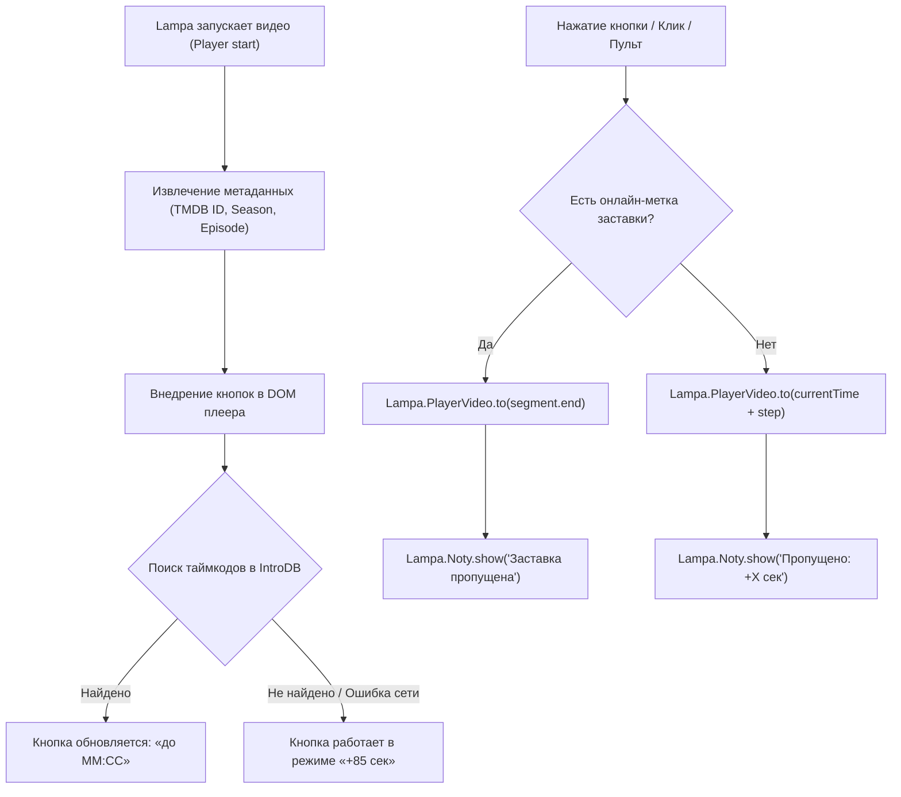

# Плагин «Пропуск интро» для Lampa (lampa-skip-intro)

Технический паспорт и документация плагина для кроссплатформенного медиаплеера Lampa (Smart TV: LG webOS, Samsung Tizen, Android TV, Apple TV, Web/PWA).

Репозиторий GitHub: [https://github.com/manka81/lampa-skip-intro](https://github.com/manka81/lampa-skip-intro)  
Автор: **manka81**  
Версия: **1.0.1**  
Лицензия: **MIT**

---

## 1. Стек технологий

- **Язык**: JavaScript (ES5/ES6 compatibility for legacy Smart TV WebViews).
- **Среда выполнения**: Встроенные браузерные движки Lampa (Chromium, WebKit Tizen, webOS Blink).
- **Сборщик / Среда разработки**: Node.js v26.10.0 (валидация синтаксиса `vm.Script`, генерация `dist/`).
- **Скрипты автоматизации**: `build.bat` (чистый ASCII без BOM для Windows CMD), PowerShell.
- **Внешние API**: IntroDB REST API (`https://api.introdb.app/v1/segments`) для онлайн-поиска таймкодов опенингов.
- **Интеграция с UI Lampa**: `Lampa.Player`, `Lampa.PlayerVideo`, `Lampa.SettingsApi`, `Lampa.Keypad`, `Lampa.Storage`, `Lampa.Noty`.

---

## 2. Структура файлов проекта

```text
C:\Users\manka\.gemini\antigravity\scratch\Пропуск_Интро_Лампа\
│
├── src/
│   └── plugin.js            # Исходный код плагина с подробными комментариями
│
├── dist/
│   ├── plugin.js            # Собранный дистрибутив для подключения по URL
│   └── plugin.min.js        # Минимизированная облегченная версия плагина
│
├── build.js                 # Node.js скрипт сборки и проверки синтаксиса
├── build.bat                # ASCII-батник для интерактивной демонстрации компиляции
├── package.json             # Метаданные npm проекта
└── README.md                # Главный технический паспорт проекта (данный файл)
```

---

## 3. Назначение модулей и компонентов

| Модуль / Компонент | Назначение |
| :--- | :--- |
| `src/plugin.js` | Главный модуль плагина, оформленный в самовызывающуюся функцию (IIFE). Содержит регистрацию настроек Lampa, перехват событий плеера, внедрение кнопок и логику перемотки. |
| `SkipIntro.initSettings` | Интеграция в системное меню Lampa: `Настройки` $\rightarrow$ `Пропуск интро`. Позволяет настраивать шаг перемотки (60/75/85/90/120 сек), видимость кнопок и горячие клавиши пульта. |
| `SkipIntro.setupButtons` | Генерирует два элемента интерфейса: 1) всплывающую полупрозрачную кнопку с анимацией над таймлайном; 2) кнопку быстрого прыжка `+85s` в нижней панели плеера (`.player-panel__right`). |
| `SkipIntro.doSkip` | Интеллектуальный исполнитель перемотки: если доступна точная онлайн-метка заставки — перематывает ровно в конец заставки; если нет — выполняет гарантированный ручной прыжок на заданное число секунд. |
| `SkipIntro.onKeyDown` | Обработчик пультов Smart TV (`Keypad`): поддержка зеленой (404), желтой (405), синей (406) кнопок и клавиши перемотки `FastForward`. |
| `build.js` | Читает `src/plugin.js`, валидирует через `vm.Script` на отсутствие синтаксических ошибок, копирует в `dist/plugin.js` и сжимает в `dist/plugin.min.js`. |

---

## 4. Архитектура данных и поток событий



---

## 5. Способы подключения плагина в Lampa

Для установки плагина в приложении Lampa:
1. Перейдите в **Настройки** $\rightarrow$ **Расширения** (или «Плагины»).
2. Нажмите **Добавить плагин**.
3. Введите один из следующих URL-адресов:

* **Через CDN jsDelivr (Рекомендуется для ТВ без блокировок MIME-типов)**:
  ```text
  https://cdn.jsdelivr.net/gh/manka81/lampa-skip-intro@main/dist/plugin.js
  ```
* **Прямая ссылка GitHub Raw**:
  ```text
  https://raw.githubusercontent.com/manka81/lampa-skip-intro/main/dist/plugin.js
  ```

4. Нажмите **Добавить** и перезапустите Lampa.

---

## 6. Журнал изменений (Changelog)

### Версия 1.0.1 (17.11.2026)
- Установлено значение по умолчанию: **98 секунд (1 минута 38 секунд)** для точного пропуска заставки.
- В настройки Lampa добавлен пресет `98 секунд (1 мин 38 сек)` с автоматическим обновлением отображения на кнопках `+98s`.

### Версия 1.0.0 (17.11.2026)
- **Первоначальный релиз**:
  - Полная поддержка Smart TV (Tizen, webOS, Android TV) и Web-версии.
  - Гибридный режим: автоматический поиск таймкодов опенингов в IntroDB + гарантированный ручной прыжок (по умолчанию +85 сек).
  - Два типа кнопок: стильная всплывающая кнопка на экране с фокусом пульта (`selector`) и постоянная кнопка в нижней панели плеера.
  - Интеграция с меню `Lampa.SettingsApi` (выбор шага перемотки, включение/выключение компонентов, назначение цветных кнопок пульта).
  - Сборка и валидация через Node.js.
